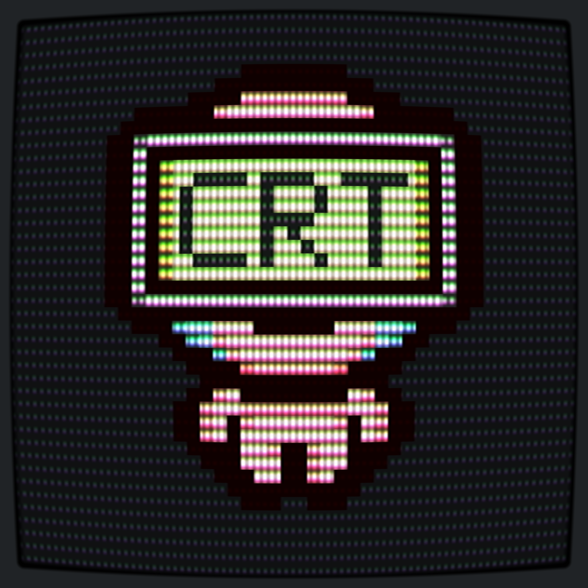
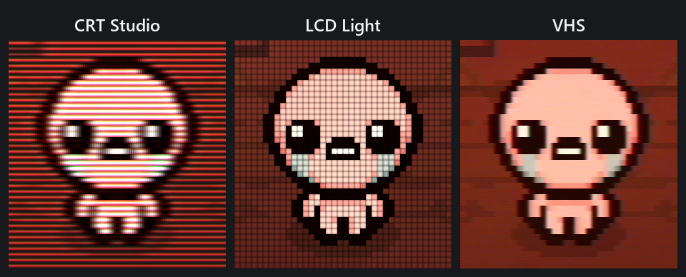
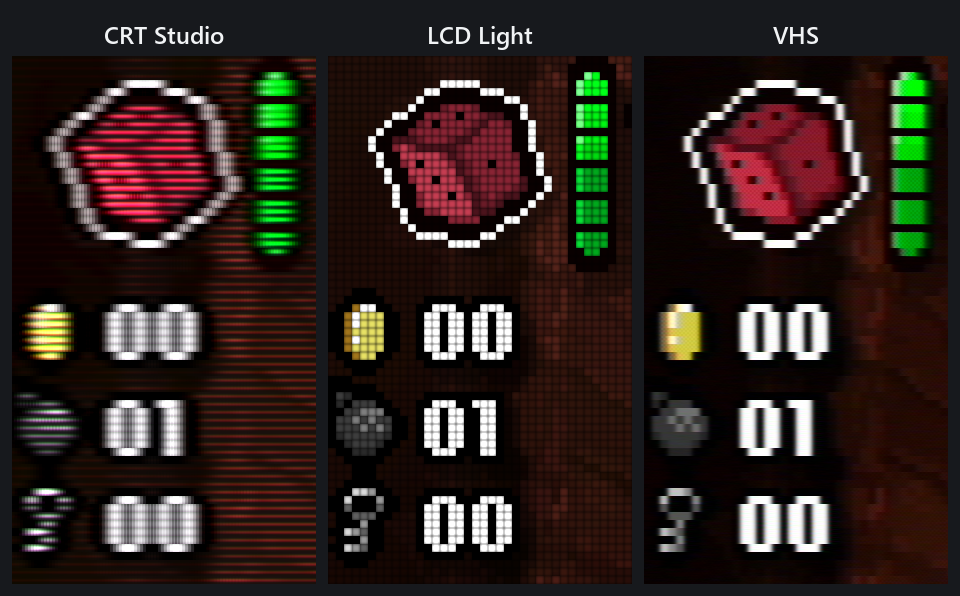

# Isaac CRT

Give **The Binding of Isaac: Repentance+** a little old-screen charm:
CRT phosphors, LCD cells and VHS texture.

## A closer look

**Isaac sprite**

**HUD**

## Controls

- **F7:** CRT Core → CRT Studio → LCD Light → LCD Strong → VHS → Off.
- **F6:** Toggle Flat/Curved for CRT Core, CRT Studio and VHS,
  or Ghosting On/Off for LCD Light and LCD Strong.

## Installation

Download [Isaac CRT 1.0](https://github.com/vici1129/isaac-crt/releases/tag/v1.0.0).

Close Isaac and copy the package's `opengl32.dll` beside `isaac-ng.exe`.
With REPENTOGON, place it beside `Repentogon/isaac-ng.exe`.
Launch through Steam. Linux and Steam Deck also need a Steam Launch Option:
see [INSTALL.txt](INSTALL.txt) for installation and removal.

Browse the [screenshots folder](screenshots/) for all five treatments and Off,
or see the [changelog](CHANGELOG.md).

Isaac CRT is a free spin-off of
[Beamline](https://store.steampowered.com/app/5344440/),
which brings CRT, LCD and VHS effects to other supported games.

An unofficial project, not affiliated with or endorsed by the game's creators.
