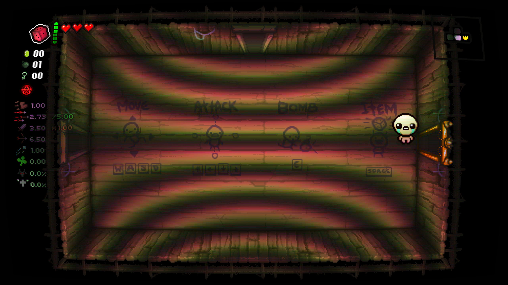

# Isaac CRT

A small, native graphics mod for **The Binding of Isaac: Repentance+**.
A personal tribute: CRT phosphors, LCD cells and VHS texture, with two keys
and no launcher or configuration window.

## Controls

**F7** cycles CRT Core → CRT Studio → LCD Light → LCD Strong → VHS → Off.
**F6** switches Flat/Curved for CRT Core, CRT Studio and VHS, or Ghosting
On/Off for LCD Light and LCD Strong. It has no effect in Off mode.

A sharp top-left toast shows each change for about 1.5 seconds, including the
LCD variant and ghosting state. Treatment, curvature and ghosting are saved.
Ghosting defaults to Off, is independent of curvature, and keeps your selection
when switching between LCD Light and Strong. There are no bezels, reflections,
advertisements or additional mod hotkeys.

Off skips image-treatment passes entirely. Its brief notification is the only
mod drawing; after that disappears, no mod framebuffer copy or drawing occurs.

## Installation

Close Isaac, then copy the package's **opengl32.dll** beside **isaac-ng.exe**.
Launch normally through Steam. If an `opengl32.dll` already exists, stop—never
overwrite another mod's proxy. See [full installation/removal instructions](INSTALL.txt).

No Beamline installation, REPENTOGON, Workshop subscription, external launcher
or separate runtime installer is needed. The game executable is not modified.

## Status

**0.1.0 is an experimental, locally validated build. No GitHub Release has been
published yet.** This public repository contains documentation and selected
game screenshots only. Implementation, shader definitions, preset data and
development artifacts are maintained separately in a private repository.

Tested on Steam Repentance+ v1.9.7.17, Windows and an RTX 5070 Ti at a
2560×1440 display resolution, with Epic overlay enabled. Checks cover all six
modes, CRT/VHS curvature, menus, movement, room transitions, restart animations,
resizing, saved selections and normal shutdown. LCD Light/Strong ghosting On
and Off were also tested with movement, shooting, treatment switching, resizing,
saved-state relaunches and normal shutdown. This is not a broad hardware
or long-session certification. Online play, other game editions and combinations
with other native graphics proxies are untested.

The mod uses Isaac's 480×270 logical grid for raster positioning without
pretending the final framebuffer is a native 480×270 source. It preserves the
existing multipass treatments and optical response derived from Beamline's
OpenGL renderer, independently of the commercial application.

See [screenshots](SCREENSHOTS.md) and the [changelog](CHANGELOG.md).
This is an unofficial project, not affiliated with the game's creators.
