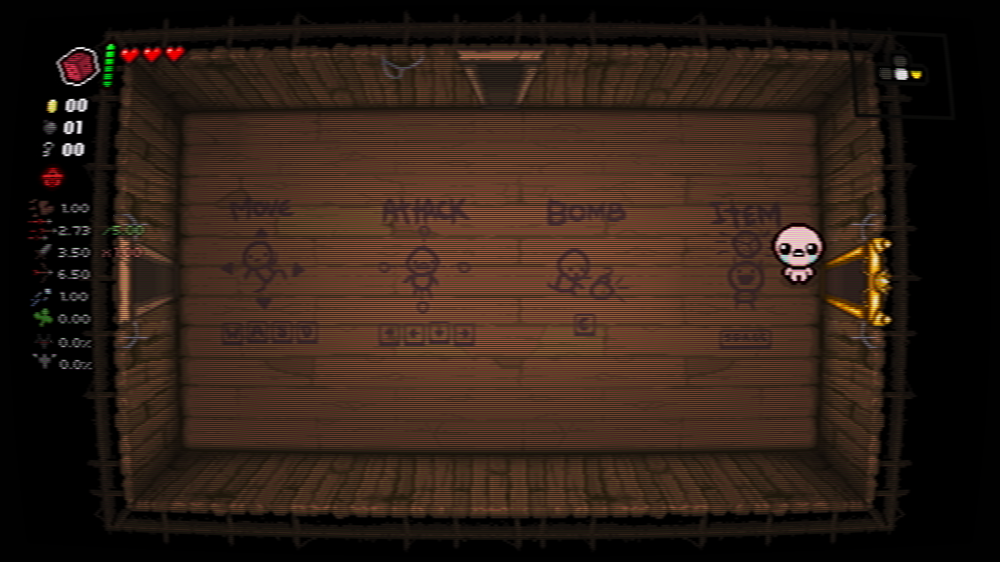
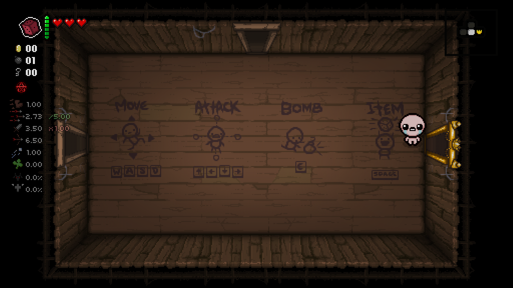
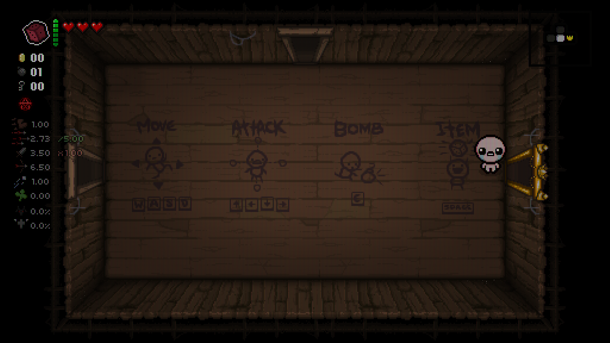
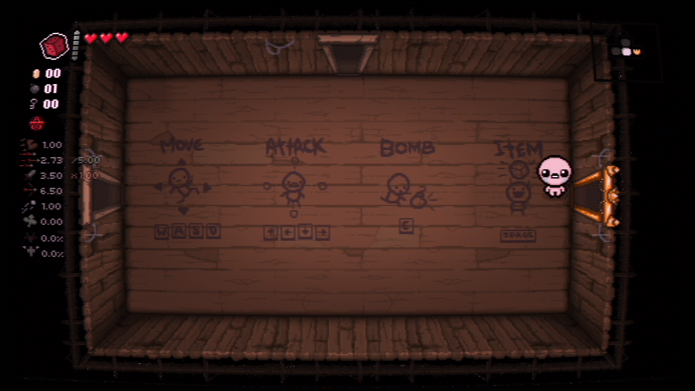

# In-game screenshots

Captured directly in Steam Repentance+ on a 2560×1440 display. These are game
captures, not offline shader previews. Open at native size: browser rescaling
can distort fine phosphor/cell patterns. CRT and VHS examples below use Curved;
both also support Flat. LCD and Off remain flat.

## CRT Core

## CRT Studio

## LCD Light

## LCD Strong

## VHS

## Off

